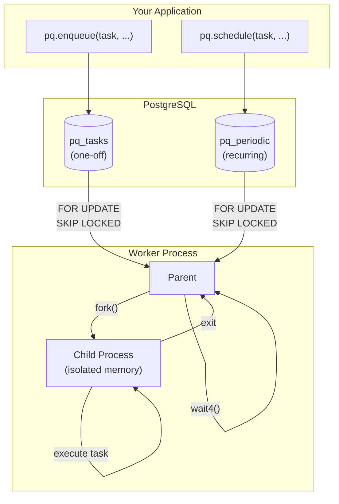
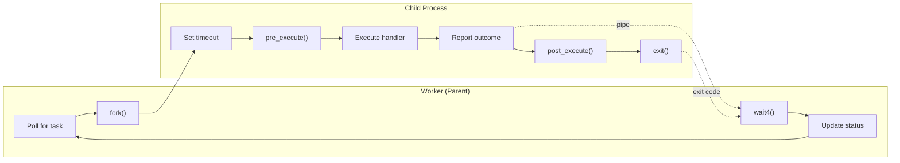
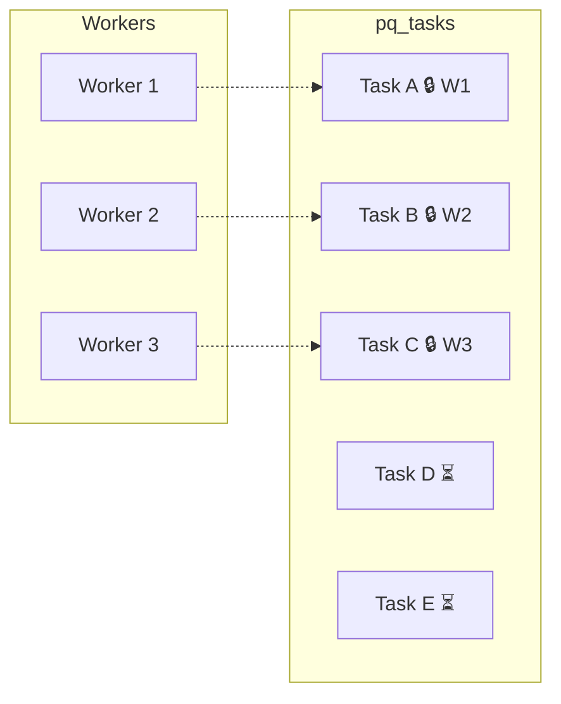
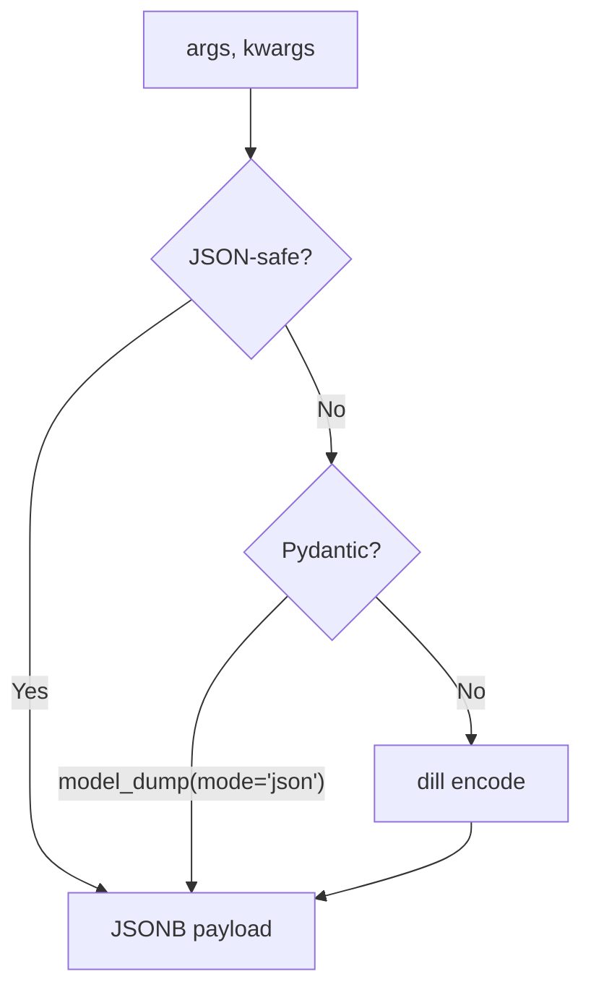
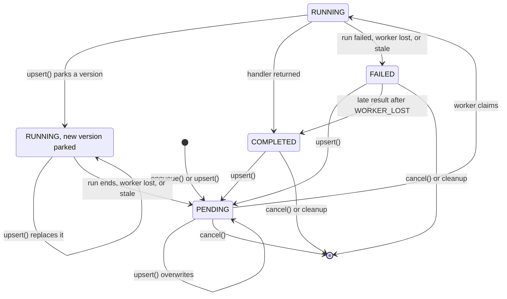

# Architecture

## Overview



## Components

### PQ Client

The main interface for your application:

```python
from pq import PQ

pq = PQ("postgresql://localhost/mydb")

# Enqueue one-off tasks
pq.enqueue(send_email, to="user@example.com")

# Schedule recurring tasks
pq.schedule(cleanup, run_every=timedelta(hours=1))
```

### PostgreSQL Tables

**`pq_tasks`** - One-off tasks:

| Column | Purpose |
|--------|---------|
| `name` | Function path (e.g., `myapp.tasks:send_email`) |
| `payload` | JSONB with serialized args/kwargs |
| `priority` | 0-100, higher runs first |
| `status` | pending → running → completed/failed |
| `run_at` | Scheduled execution time |
| `error` | Error message if failed |
| `failure_kind` | Why it failed: `error`, `timeout`, `oom`, `killed`, `shutdown`, `worker_lost` or `stale` |
| `requeue` | JSONB with the next version, stored by an `upsert()` that arrived while the task was running. Applied when the run ends |
| `worker_id` | The `pq_workers` row of the worker running it. Set by the claim, cleared when the run ends |
| `claimed_max_runtime_seconds` | The max runtime of the run in progress: the task's own, or the default of the worker that claimed it |

**`pq_periodic`** - Recurring schedules:

| Column | Purpose |
|--------|---------|
| `name` | Function path (unique with `key`) |
| `key` | Discriminator for multiple schedules of the same function (default `""`) |
| `payload` | JSONB with serialized args/kwargs |
| `priority` | 0-100, higher runs first |
| `run_every` | Interval (e.g., 1 hour) |
| `cron` | Cron expression (e.g., `0 9 * * 1`) |
| `active` | Whether the task is executed (default `true`) |
| `next_run` | Next scheduled execution |

**`pq_workers`** - Running workers:

| Column | Purpose |
|--------|---------|
| `hostname`, `pid` | Where the worker runs |
| `started_at` | When it started |
| `expires_at` | End of its heartbeat lease. The worker moves it 60 s ahead every 15 s |

## Fork Isolation

Every task runs in an isolated child process:



When the handler returns or raises, the child writes the outcome to a pipe, before `post_execute` runs. That outcome is the task's result, however the process ends afterwards. If the child wrote nothing, the handler did not get to its end, and the way the process ended decides:

| What the worker sees | Result | `failure_kind` |
|----------------------|--------|----------------|
| Pipe: handler returned | `COMPLETED` | |
| Pipe: error report | `FAILED` with the traceback | `error` |
| Exit code 124 (the child stopped itself), or the worker's SIGKILL 10 s after `max_runtime` | `FAILED` with timeout | `timeout` |
| The worker's SIGKILL at the end of its drain | `FAILED` with shutdown error | `shutdown` |
| SIGKILL from outside (signal 9) | `FAILED` with OOM | `oom` |
| Other signals | `FAILED` with signal | `killed` |

**Benefits:**

- **Memory isolation** - Child OOM doesn't crash worker
- **Crash isolation** - Segfaults only kill the child
- **Clean state** - Each task starts fresh
- **Hook safety** - Lifecycle hooks run in the child, safe for fork-unsafe resources

### Lifecycle Hooks

Optional `pre_execute` and `post_execute` hooks run in the forked child:

```python
from pq import Task, Periodic

def pre_execute(task: Task | Periodic) -> None:
    # Initialize fork-unsafe resources (OTel, DB connections)
    pass

def post_execute(task: Task | Periodic, error: Exception | None) -> None:
    # Cleanup/flush (OTel traces, etc.)
    pass

pq.run_worker(pre_execute=pre_execute, post_execute=post_execute)
```

This is essential for OpenTelemetry and similar libraries that don't survive `fork()`.

## Concurrency

Multiple workers safely process tasks in parallel using PostgreSQL's `FOR UPDATE SKIP LOCKED`:



```sql
UPDATE pq_tasks
SET status = 'RUNNING', started_at = now(), attempts = attempts + 1,
    worker_id = :worker_id,
    claimed_max_runtime_seconds = coalesce(max_runtime_seconds, :worker_max_runtime)
WHERE id = (
    SELECT id FROM pq_tasks
    WHERE status = 'PENDING' AND run_at <= now()
    ORDER BY priority DESC, run_at
    LIMIT 1
    FOR UPDATE SKIP LOCKED
)
RETURNING *;
```

- `FOR UPDATE` locks the selected row
- `SKIP LOCKED` skips rows locked by other workers
- Each task runs exactly once
- The partial index `ix_pq_tasks_pending` holds the pending rows in this order, so a claim reads its first entry however long the backlog is

One-off tasks and periodic schedules form one queue: priority first, then the time they came due. Before the claim above, the worker reads the first due schedule. If there is one, the task is claimed only if it goes before it; otherwise the schedule is claimed, in a transaction that locks it and advances it to its next run.

Claiming a task, recording its result and enqueuing are one statement each, sent in autocommit: no `BEGIN` and `COMMIT` round trips. A poll that finds nothing costs three statements (connection check, read of the schedules, claim), a processed task five, an enqueue two. The heartbeat adds a connection check and up to two statements per worker every 15 seconds.

## Priority System

Tasks are processed in priority order (higher first):

| Priority | Value | Use Case |
|----------|-------|----------|
| `CRITICAL` | 100 | User-facing, time-sensitive |
| `HIGH` | 75 | Important but less urgent |
| `NORMAL` | 50 | Default |
| `LOW` | 25 | Background work |
| `BATCH` | 0 | Bulk operations |

Dedicated workers can handle specific priorities:

```python
# High-priority worker
pq.run_worker(priorities={Priority.CRITICAL, Priority.HIGH})

# Batch worker
pq.run_worker(priorities={Priority.BATCH})
```

## Serialization



| Type | Method |
|------|--------|
| str, int, list, dict, None | JSON |
| Pydantic models | `model_dump(mode="json")` → JSON |
| Lambdas, closures, custom objects, and values JSONB rejects (`NaN`, a NUL character in a string) | dill (pickle-like) |

## Task Lifecycle



Each transition is one SQL statement whose `WHERE` clause is its guard. `cancel()` does not match a RUNNING row.

`upsert()` on a RUNNING task does not change the run in progress. It stores the new version in `requeue`. When the run ends (success, failure, timeout, shutdown, or a reap), the row goes back to PENDING with that version instead of COMPLETED or FAILED. So one `client_id` does not run twice at the same time.

The worker records the end of a run only if the row still belongs to that run: it is RUNNING with the `started_at` of the run's claim. A run that ends after its row was reaped and claimed again leaves the row alone.

### Rows left RUNNING

A row can stay RUNNING with no run behind it. Two checks find such rows, and both fail the row or, if a version is parked, re-queue it:

- **Worker lost.** Each worker holds a lease in `pq_workers` and renews it every 15 s. A RUNNING row whose `worker_id` points at a lease that ran out (60 s without a renewal), or at no row, is orphaned. Every worker runs this check after each of its own heartbeats, once it has itself renewed on time for a whole lease. That wait matters after a database outage: every lease has run out then, and the live workers have to renew before anyone judges them. On Linux a task's process is killed by the kernel when its worker dies (`PR_SET_PDEATHSIG`), so an orphaned row has no process behind it.
- **Stale.** A row that has been RUNNING for longer than `stale_task_timeout` (default 1 hour) and twice its `claimed_max_runtime_seconds`. This covers rows without a worker id (`run_worker_once`) and runs whose result could not be written.

A worker that was cut off from the database and comes back may find its tasks failed as `worker_lost` while they ran. When such a run ends, its result replaces the verdict, unless the row was re-queued in the meantime.

## File Structure

```
src/pq/
├── __init__.py      # Public API exports
├── client.py        # PQ class - main interface
├── worker.py        # Worker loop and fork execution
├── models.py        # SQLAlchemy models (Task, Periodic, Worker)
├── priority.py      # Priority enum
├── serialization.py # JSON/Pydantic/dill serialization
├── registry.py      # Function path resolution
└── logging.py       # Loguru configuration
```
